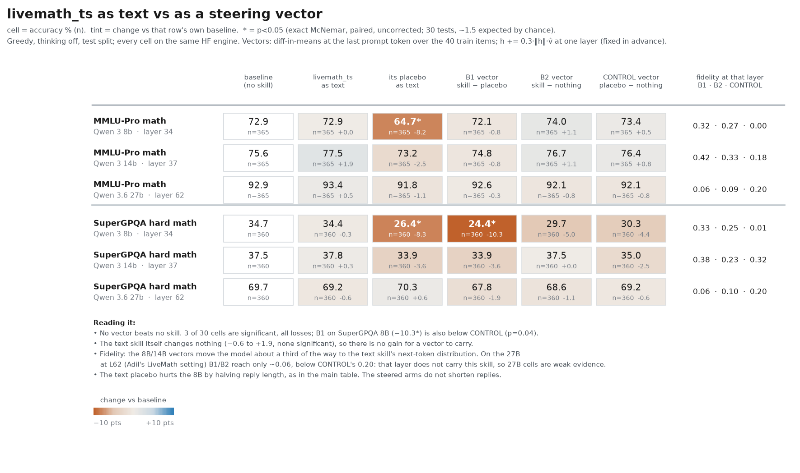

# Adilet's runs: text skills on math benchmarks without answer-format shortcuts

Status 2026-10-25: **all stages finished**, including the livemath_ts variants on every benchmark. Box: 2 × RTX PRO 6000 Blackwell, vLLM 0.32,
greedy, thinking off. The summary table is `math_skills_table.png`
(`make_math_skills_table.py`, cells in `math_skills_cells.json`, computed from the saved
per-question results).

## Main conclusion

**No text skill beats giving the model no system prompt**, on 7 math benchmarks that
have no answer-format shortcut, for Qwen3-8B, Qwen3-14B and Qwen3.6-27B, with
PROTOCOL.md's selection rule. 16 of the table's 147 comparisons are significant
(p<0.05, uncorrected; ~7 are expected by chance): **15 are losses**, and the one gain
(MMLU-Pro 14B, +5.5) reverses on the 27B (−2.5, also significant) with the same text and
did not show on dev. What notes change is mostly **how long the model reasons**: the
length-matched placebos halve reply length and are the most common significant losses.

The LiveMath result this started from was a loophole: there, every skill gain came from
the meta-option "One of the remaining options is correct, but a stronger result can be
proven", correct 263/263 times (`../../skill_search/PROTOCOL.md`). Off LiveMath, the
meta rule does nothing: livemath_ts with and without it never differ significantly
(21 paired comparisons, smallest p = 0.07).

Not covered: other model families, thinking mode, optimizers stronger than
Qwen3.6-27B (the SkillOpt paper used GPT-5.5). Vector skills were run on the two MCQ
benchmarks only, and do no better (result 5; the vector results in `../` are Adil's LiveMath runs).

## The benchmarks

* **MCQ without a meta-option**, audited with no model first (`../../skill_search/mcq_math/audit_mcq.py`):
  MMLU-Pro math (TheoremQA + SciBench; centroid shortcut 11.6% against 10% chance) and
  SuperGPQA hard math (centroid 18.0%, so reported split by centroid).
* **Free-form** (no options): BeyondAIME, HARDMath2, RealMath, IMO-AnswerBench,
  ArxivMath (SkillOpt target Qwen3-14B; 8B was at the floor).

Pipelines: `../../skill_search/skillopt_local/freemath/` and `.../mcqmath/` (SkillOpt envs
and launchers), `../../skill_search/mcq_math/` (kit-prompt runners, PROTOCOL.md selection).

## Results, in the order they were produced

**1. LiveMath skills transferred to clean MCQ** (8B, kit prompt + forcing, 2048 tokens).
`reports/mcq_transfer_kit_stack_qwen3-8b.txt`. No skill beats no-system-prompt; the
placebos hurt (MMLU-Pro 72.7 → 64.0, SuperGPQA 34.8 → 28.0) by halving reply length.
"livemath_ts beats its placebo" holds only because that placebo is harmful.

**2. SkillOpt, 8B target, SkillOpt's own stack.** `reports/freemath_forced_qwen3-8b.txt`,
`reports/mcqmath_skillopt_stack_qwen3-8b.txt`. Val gains did not reach test. SkillOpt
measures progress against its *seed*, never against no skill: on SuperGPQA the seed
itself costs ~10 points, so "+2 over the seed" was still −7 against nothing.

**3. PROTOCOL.md stage (the table).** SkillOpt is only the draft generator. Drafts are
chosen on dev by the mean gain over the three models (centroid disqualification for MCQ;
ties to the shorter skill), then the test split is evaluated once, with the kit's prompt
and forcing (2048 tokens, 4096 for the 27B).
`protocol/<mcq bench>/report_rescored.txt`, `protocol_fm/<bench>/report.txt`, and the
selections next to them. **On all 7 benchmarks the chosen draft is SkillOpt's 4-line
seed, or the seed plus empty tags**: every longer, optimized draft lost on dev.

**4. livemath_ts, its placebo, and livemath_ts + meta rule on every benchmark** (test
splits, same stack as 3; `../../skill_search/mcq_math/run_ts_meta.sh`,
`../../skill_search/skillopt_local/freemath/run_ts_fm.sh`). Columns 5–7 of the table.
* **The meta rule is inert without a meta-option.** livemath_ts_meta vs livemath_ts:
  0 of 21 pairs significant. On LiveMath the same rule took the 14B from 3.4% to 26.3% on
  meta-option questions; here there is nothing for it to act on.
* **livemath_ts is an MCQ skill, and on free-form questions the small models make up
  options.** It says to compare the options; with no options the 8B often derives the
  right value, then writes "Among the options, Option A …" and answers `\boxed{A}`. Share
  of free-form replies that are a bare letter, livemath_ts / with meta rule:
  RealMath 8B 186/287 and 193/287, 14B 64/287 and 46/287; IMO 8B 59/205 and 67/205;
  ArxivMath 8B 26/43 and 28/43; HARDMath2 8B 26/121 and 37/121; never more than 6 for
  the 27B. Those cells are marked † (≥ 20%). Their significant losses (RealMath 8B
  −12.5/−14.3, 14B −5.9; IMO 8B −9.8/−10.2) are format failures, not worse reasoning.
* **"livemath_ts beats its placebo" is not a skill effect.** It holds on MMLU-Pro 8B
  (+54/−24) only because that placebo is harmful (−7.1*); nowhere does livemath_ts beat
  no skill.
* The placebo for livemath_ts shortens replies everywhere (RealMath 8B: 2586 → 531
  characters) and significantly hurts on MMLU-Pro 8B and 14B, SuperGPQA 8B and IMO 14B,
  where the problems need the room.

**5. Vector arm of livemath_ts on MMLU-Pro and SuperGPQA** (`../../skill_search/vector_mcq/`,
table `vector_arm/vector_table.png`, report and fidelity in `vector_arm/`). Three vectors per
model and benchmark, diff-in-means at the last prompt token over the 40 train-split items
(kit hooks): B1 = skill − placebo, B2 = skill − nothing, CONTROL = placebo − nothing. Fixed
in advance at Adil's LiveMath settings (8B L34, 14B L37, 27B L62, γ = 0.3, relative). Every
cell, text ones included, on the same HF engine.

* **No vector beats no skill.** 3 of 30 cells are significant, all losses (two are the text
  placebo); B1 on SuperGPQA 8B (−10.3) is also below CONTROL (p=0.04).
* The text skill itself changes nothing here (−0.6 to +1.9), so there is no gain to carry.
* The 8B/14B vectors do carry part of the text skill's effect on the next-token
  distribution (fidelity 0.23–0.42). On the 27B at L62, B1/B2 fidelity is ~0.06, below
  CONTROL's 0.20: that operating point does not carry this skill, so the 27B vector cells
  are weak evidence.
* The SuperGPQA 27B cells were rerun once: the first run crashed out of memory in the
  forcing pass, and a logging bug hid it (both fixed, `vec_mcq.py`, `run_vec_mcq.sh`).

## Skill audit: do any skills exploit the benchmark format?

| skill | format-exploiting content | effect |
|---|---|---|
| strength_audit | **yes**: step 5, the meta-option rule | its whole LiveMath gain; nothing elsewhere |
| strength_audit_nometa | no | flat |
| livemath_ts | partly: says "the wrong ones usually differ from the right one in a single detail" (the basis of the centroid shortcut), never says to use it | none: on LiveMath its gain was larger where the centroid is *wrong* (+8.0 vs +6.3), and its placebo matched it. Off MCQ it makes small models invent options (result 4) |
| livemath_ts_meta | **yes**: livemath_ts plus the meta-option rule | the LiveMath META gain; elsewhere identical to livemath_ts |
| placebos | no procedure; "don't pad" shortens replies | they hurt; a length effect |
| SkillOpt MCQ skills | mostly method; two **memorized training items** (the ∛130 answer key `5.06577778`, Fermat primes for a polygon question, both in the train split) and one guessing rule ("pick the option with the same structure as your result") | no gain on centroid-right items; neither memorizing version was chosen |
| SkillOpt free-form skills | method plus **benchmark-construction priors** (HARDMath2 "reject constant answers", "amplitude is ALWAYS Q^(−1/4)"; RealMath "never answer 'cannot be determined'"), anti-loop rules | none significant |
| SkillOpt LiveMath skill (Adil) | **yes**: "Meta-Option Absolute Priority" | the LiveMath gain |

## Things that went wrong, and are fixed

* **math-verify in threads**: its timeouts use `signal.alarm()`, so inside SkillOpt's
  rollout threads every symbolic/numeric check failed silently. Fixed with a process
  pool; runs scored before the fix were redone.
* **Format clash**: SkillOpt skills say "answer as `<answer>X</answer>`", the kit prompt
  says "`Answer: <letter>`", and the model writes hybrids (`Answer: <answer>G</answer>`).
  The strict parser read none of them. `mcq_math/evaluate_vllm_mcq.py` now reads every
  committed form; all protocol results were re-scored from saved replies.
* **GPU 0 produced garbage silently after a reboot** (64/64 `locklocklock…`, no error):
  two SkillOpt steps were rolled back and redone; the card was reset.
  `orchestration/gpu_garbage_probe.py` is the 2-minute check.
* **Another user's training grew into our card mid-cell** and OOM-killed an 8B cell; the
  protocol stage now waits for an idle GPU (the kit's < 2 GB rule).
* **A cut-off rescore** (reboot) replaced a full result file with 162 of 287 rows;
  `analyze_freemath.py` now uses a rescored file only when it is complete.
* Reboots kill tmux: launchers skip training only when `summary.json` exists, and
  SkillOpt resumes from `runtime_state.json`.

## What is in this folder

| path | contents |
|---|---|
| `math_skills_table.png`, `make_math_skills_table.py`, `math_skills_cells.json` | the summary table above |
| `compute_math_skills_cells.py` | builds the cells from the saved per-question results (run on the box) |
| `reports/` | results 1 and 2 (results 3 and 4 are in `protocol*/`) |
| `protocol/<mcq bench>/`, `protocol_fm/<bench>/` | PROTOCOL.md selection (dev), chosen draft, test report |
| `skills_learned/<run>/` | every SkillOpt skill version, `best_skill.md`, `summary.json`, `history.json` (no transcripts: they contain benchmark text) |
| `vector_arm/` | vector-arm table (`make_vector_table.py`, `compute_vector_cells.py`), report and fidelity per model and benchmark |
| `orchestration/` | the box scripts that chained the runs, and the GPU garbage probe |
| `make_table.py`, `latent_skills_table_updated.png` | the earlier LiveMath table |
