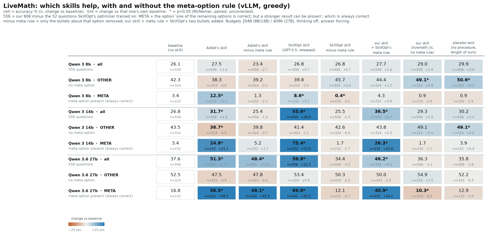

# LiveMath skill files: what each one does, and which is best

Every `.md` file in this folder is **model-visible** text: it goes into the system
prompt as is. Design notes live in `notes/README.md`, not in the skill files.

All numbers below are generated by scripts (see "Reproduce"); none are typed by hand.

## TL;DR

* **No skill here improves the actual maths beyond what a placebo text does.** Every large gain on LiveMath
  comes from one shortcut, the *meta-option* (explained below).
* **Highest raw score:** `skillopt/skillopt_full.md` (Microsoft SkillOpt's released
  skill): 14B 26.8 → 55.6, 27B 37.6 → 59.9. Almost all of it is the shortcut: remove its
  two meta-option bullets and it is *below* baseline on 14B and 27B.
* **Best on the questions without the shortcut (OTHER):** `livemath_ts.md`. It is the only
  skill that is positive on OTHER for all three models (+6.8\*, +5.6, +2.5).
  **But a placebo text of the same length, with no procedure in it, does just as well**
  (OTHER +8.3\*, +5.6\*, −0.3; ours minus placebo −1.5 / +0.0 / +2.8, pooled p=0.86).
  So the gain is from having a system prompt, not from what this one says.
* **Always report OTHER and META separately.** "All questions" mixes a real-maths number
  with a shortcut number and is not interpretable on its own.

## The meta-option shortcut (read this first)

In 263 of the 608 LiveMath questions one option reads, word for word:

> One of the remaining options is correct, but a stronger result can be proven.

* It is the correct answer in **all 263** of those questions.
* It **never** appears in the other 345.
* So "if this option is present, pick it" scores 100% on those questions without any maths.

Without a hint, models almost never pick it (baseline META accuracy: 3% for 8B and 14B,
17% for 27B). A skill that says "treat the meta-option as a serious candidate" therefore
gains up to +72 points on META questions. We call the 263 questions **META** and the
other 345 **OTHER**. OTHER is where a skill has to show it improves reasoning.

## The files

| File | What it is | Where it came from | Tokens | Meta-option rule? |
|---|---|---|---|---|
| `livemath_ts.md` | 5-step procedure: pin down hypotheses, read each option as a precise claim, test derivability, then compare strength | Written by us (given to the GPU runs 2026-10-13) | 450 | no |
| `livemath_ts_meta.md` | `livemath_ts.md` + SkillOpt's two meta-option bullets, verbatim, as a new step 5 | Made for the ablation (2026-10-15) | 529 | yes |
| `strength_audit.md` | 6-step strength audit, step 5 = "treat meta-options as real candidates" | Adilet (`adilet/strength-audit-skill`) | 383 | yes |
| `strength_audit_nometa.md` | `strength_audit.md` without step 5 | Ablation | 307 | no (but see below) |
| `skillopt/skillopt_full.md` | SkillOpt's released GPT-5.5 LiveMath skill, empty `SLOW_UPDATE` block stripped | [SkillOpt](https://github.com/microsoft/SkillOpt) `ckpt/`, paper [arXiv:2605.23904](https://arxiv.org/abs/2605.23904) | 643 | yes |
| `skillopt/skillopt_nometa.md` | `skillopt_full.md` without the "Meta-Options About Stronger Results" heading and its two bullets | Ablation | 565 | no |
| `skillopt/livemath_gpt5.5_skill.md` | SkillOpt's file exactly as downloaded | SkillOpt | 655 | yes |
| `skillopt/skillopt_qwen3-8b_learned.md` | Skill SkillOpt learned in our own run (Qwen3-8B target, Qwen3.6-27B optimizer) | `skill_search/skillopt_local/` | 900 | yes, as "absolute priority" |
| `search/proof_sketch.md` | Crutch-free skill chosen by the held-out skill search | `skill_search/` | 248 | no |

Placebos (length-matched, no procedure, used as controls):
`placebo_matched.md` (309 tokens), `placebo_livemath_ts.md` (455, matches `livemath_ts.md`),
`skillopt/placebo_skillopt_full.md` (636), `skillopt/placebo_skillopt_nometa.md` (552).

## Results on LiveMath

Qwen3 8B / 14B and Qwen3.6 27B, vLLM, greedy, thinking off, answer forcing,
2048 new tokens (8B, 14B) / 4096 (27B). Scored on **556 questions** = 608 minus the 52
that SkillOpt's optimizer trained on, so no column was tuned on the questions it is
scored on. Cell = accuracy % (change vs no skill; \* = p<0.05, paired McNemar, uncorrected).



| model | subset | n | baseline (no skill) | Adilet's skill | Adilet's skill minus meta rule | SkillOpt skill (GPT-5.5, released) | SkillOpt skill minus meta rule | our skill + SkillOpt's meta rule | our skill (livemath_ts, no meta rule) | placebo text (no procedure, length of ours) |
|---|---|---|---|---|---|---|---|---|---|---|
| qwen3-8b | all | 556 | 26.1 | 27.5 (+1.4) | 23.4 (-2.7) | 26.8 (+0.7) | 26.8 (+0.7) | 27.7 (+1.6) | 29.0 (+2.9) | 29.9 (+3.8) |
| qwen3-8b | OTHER | 324 | 42.3 | 38.3 (-4.0) | 39.2 (-3.1) | 39.8 (-2.5) | 45.7 (+3.4) | 44.4 (+2.2) | 49.1 (+6.8*) | 50.6 (+8.3*) |
| qwen3-8b | META | 232 | 3.4 | 12.5 (+9.1*) | 1.3 (-2.2) | 8.6 (+5.2*) | 0.4 (-3.0*) | 4.3 (+0.9) | 0.9 (-2.6) | 0.9 (-2.6) |
| qwen3-14b | all | 556 | 26.8 | 31.7 (+4.9*) | 25.4 (-1.4) | 55.6 (+28.8*) | 25.5 (-1.3) | 36.5 (+9.7*) | 29.3 (+2.5) | 30.2 (+3.4) |
| qwen3-14b | OTHER | 324 | 43.5 | 36.7 (-6.8*) | 39.8 (-3.7) | 41.4 (-2.2) | 42.6 (-0.9) | 43.8 (+0.3) | 49.1 (+5.6) | 49.1 (+5.6*) |
| qwen3-14b | META | 232 | 3.4 | 24.6 (+21.1*) | 5.2 (+1.7) | 75.4 (+72.0*) | 1.7 (-1.7) | 26.3 (+22.8*) | 1.7 (-1.7) | 3.9 (+0.4) |
| qwen3.6-27b | all | 556 | 37.6 | 51.3 (+13.7*) | 48.4 (+10.8*) | 59.9 (+22.3*) | 34.4 (-3.2) | 46.2 (+8.6*) | 36.3 (-1.3) | 35.8 (-1.8) |
| qwen3.6-27b | OTHER | 324 | 52.5 | 47.5 (-4.9) | 47.8 (-4.6) | 53.4 (+0.9) | 50.3 (-2.2) | 50.0 (-2.5) | 54.9 (+2.5) | 52.2 (-0.3) |
| qwen3.6-27b | META | 232 | 16.8 | 56.5 (+39.7*) | 49.1 (+32.3*) | 69.0 (+52.2*) | 12.1 (-4.7) | 40.9 (+24.1*) | 10.3 (-6.5*) | 12.9 (-3.9) |

### Per-skill verdict

* **SkillOpt (`skillopt_full`)**: biggest score, but META +72 (14B) / +52 (27B) and OTHER
  −2.2 / +0.9. Without the meta bullets: −1.3 (14B), −3.2 (27B). On 8B it does nothing
  (the 8B model picks the meta-option only 9% of the time even with the rule).
* **Adilet's (`strength_audit`)**: META +9 / +21 / +40, OTHER −4.0 / −6.8\* / −4.9. Removing
  step 5 kills the META gain on 8B and 14B, but **27B still gets +32 on META**: the rest
  of the skill ("prefer the strongest statement") is enough for 27B to pick the meta-option.
* **Ours (`livemath_ts`)**: no META gain (it has no meta rule), OTHER +6.8\* / +5.6 / +2.5.
  The matched placebo
  (`placebo_livemath_ts.md`, 455 tokens of writing-style rules) gets OTHER +8.3\* / +5.6\* /
  −0.3. Ours vs placebo, paired: −1.5 (p=0.69), +0.0 (p=1.0), +2.8 (p=0.35); pooled over the
  three models p=0.86. **Not distinguishable from a placebo.** It is still the best of the
  skills here on OTHER, but only because the others actively hurt OTHER.
* **Ours + meta rule (`livemath_ts_meta`)**: the meta rule buys META (+22.8\* on 14B,
  +24.1\* on 27B) and costs OTHER (+6.8 → +2.2 on 8B, +5.6 → +0.3 on 14B, +2.5 → −2.5 on
  27B). The same trade appears for every skill: the meta rule adds META accuracy and
  removes OTHER accuracy.

### Other measurements

* **Qwen3-4B, Adilet's skill** (all 608): 23.5 → 28.0 (+4.4, p=0.02); OTHER +2.3 (n.s.),
  META 0.8 → 8.0\*. Without step 5: +0.3.
* **SkillOpt run locally** (`skill_search/skillopt_local/`): SkillOpt as shipped (their
  35/17/125 split, default config), target Qwen3-8B, optimizer Qwen3.6-27B. On their 125
  test questions, in SkillOpt's own harness: 21.6 → 56.0. META 1.9 → 92.6, OTHER
  36.6 → 28.2 (n.s.). It rediscovered the shortcut on its own and wrote it as
  "Meta-Option Absolute Priority: ... it IS the correct answer".
* **Held-out skill search** (`skill_search/PROTOCOL.md`): `proof_sketch` was chosen on a
  dev split; on held-out OTHER it gave +2.6 on average (8B +2.7, 14B +5.9, 27B −0.9),
  not significant and not better than a placebo.

## Reproduce

```bash
# text arms (vLLM), one task per line, 1 GPU each
sbatch --array=0-11%8 skill_search/skillopt/task.sbatch skill_search/skillopt/eval_vllm.txt
# tables
.plotvenv/bin/python src/make_skill_compare_table_png.py   # PNG + record/tables/skill_compare.md
python3 skill_search/skillopt/analyze.py                    # all SkillOpt subsets + diagnostics
```

Raw per-question outputs are archived in `record/results_vllm/{full,skillopt,ts}/`.

## Transfer to OfficeQA and SpreadsheetBench (in progress)

The math skills are also being tested off LiveMath, each as text and as a steering vector
(vs placebo and vs nothing), on OfficeQA (text-only: question + the cited bulletin pages,
SkillOpt's "offline, no tools" setting, `data/prepare_officeqa_oracle.py`) and
SpreadsheetBench (single-turn). Task lists and scripts: `skill_search/transfer/`.
Results will be added here.
